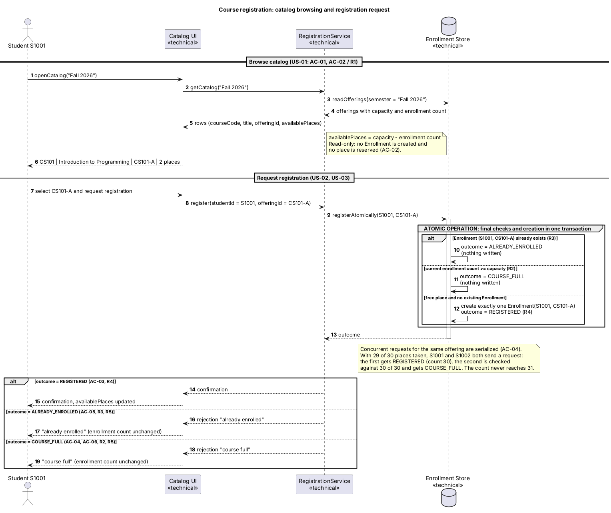
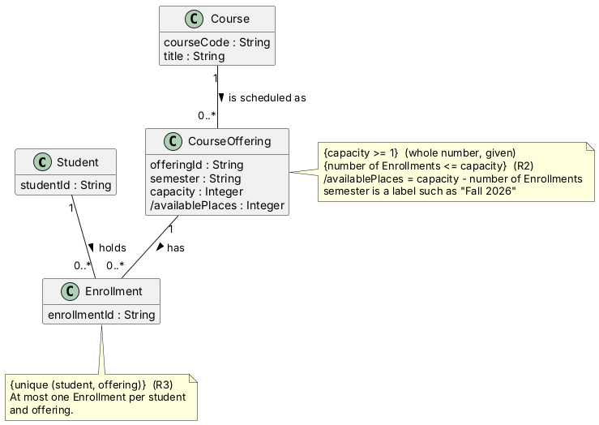

# SIS #02 — AI-Assisted UML Modeling: University Course Registration

## 1. Scope and assumptions

**Scope:** I model how a signed-in student browses the course catalog for one semester, chooses a course offering and requests registration, and receives either a confirmation or a clear rejection ("course full" or "already enrolled"). Payments, prerequisites, timetable clashes, waiting lists and cancellation are out of scope.

**Assumptions:**

1. A semester is a label such as "Fall 2026" stored as an attribute of the course offering; it is not a separate entity with its own rules.
2. A student is identified by a student ID and is already signed in, so authentication is not modeled.
3. Available places equal the offering's capacity minus the number of existing enrollments, and this number is rechecked at the moment of registration, because a catalog view does not reserve a place.

## 2. User stories and acceptance criteria

### US-01 — Browse offerings

**US-01:** As a student, I want to see the courses offered in a chosen semester with their available places, so that I can decide which offering to register for.

- **AC-01** (R1): Given the Fall 2026 offering CS101-A "Introduction to Programming" has capacity 30 and 28 enrollments, When student S1001 views the catalog for Fall 2026, Then the catalog shows the course code CS101, the title, offering CS101-A and 2 available places.
- **AC-02** (R1): Given CS101-A has capacity 30 and 28 enrollments, When S1001 opens the catalog and does not request registration, Then no Enrollment is created, the enrollment count stays 28 and the available places stay 2 for every student.

### US-02 — Register for an offering

**US-02:** As a student, I want to register for a specific course offering and receive a confirmation, so that I know I hold a place.

- **AC-03** (R2, R4): Given CS101-A has capacity 30 and 10 enrollments, and S1001 has no enrollment in it, When S1001 requests registration for CS101-A, Then exactly one Enrollment linking S1001 and CS101-A is created, the enrollment count becomes 11, the available places become 19 and S1001 receives a confirmation.
- **AC-04** (R2, R4, R5): Given CS101-A has capacity 30 and 29 enrollments, and S1001 and S1002 each have no enrollment in it, When both send a registration request concurrently, Then exactly one request succeeds with one Enrollment created, the other is rejected as "course full", and the enrollment count is 30, never 31. 

### US-03 — Receive a clear rejection

**US-03:** As a student, I want a clear reason when my registration is refused, so that I know whether it was because the offering is full or because I am already enrolled.

- **AC-05** (R3, R5): Given S1001 already has an Enrollment in CS101-A, When S1001 requests registration for CS101-A again, Then the request is rejected with "already enrolled", no new Enrollment is created and the enrollment count is unchanged.
- **AC-06** (R2, R5): Given CS101-A has capacity 30 and 30 enrollments, S1003 has no enrollment in it, and an earlier catalog view showed S1003 a place, When S1003 requests registration for CS101-A, Then the request is rejected with "course full", no Enrollment is created and the enrollment count stays 30.

## 3. Sequence diagram

**Participants:** Student S1001 (actor representing the user), Catalog UI (boundary component for viewing), RegistrationService (control component handling logic), and Enrollment Store (database storing system state).

**Atomic operation:** The messages executing the duplicate check, the capacity check, and the creation of the Enrollment inside the `registerAtomically` transaction form the atomic step. A catalog view reserves nothing and only fetches read-only derived data.

**Where the Enrollment is created:** The message `create exactly one Enrollment` sent within the database lifeline creates the `Enrollment` class instance defined in section 4.

**Technical lifelines:** Catalog UI, RegistrationService, and Enrollment Store are technical components representing UI, service, and database layers respectively. This difference in abstraction from domain classes is standard and acceptable.

## 4. Class diagram

| Association | Read left to right | Read right to left |
| --- | --- | --- |
| Course -- CourseOffering | Course is scheduled as CourseOffering | CourseOffering belongs to Course |
| Student -- Enrollment | Student holds Enrollment | Enrollment is held by Student |
| CourseOffering -- Enrollment | CourseOffering has Enrollment | Enrollment is for CourseOffering |

**How an Enrollment links a student to an offering:** An Enrollment associates exactly one Student instance with exactly one CourseOffering instance, tracking their participation.

**Capacity constraint:** Capacity is enforced via a note `{number of Enrollments <= capacity}` on CourseOffering because class multiplicities cannot express dynamic runtime inequalities between attributes and count values.

**Uniqueness constraint:** Uniqueness is enforced via a note `{unique (student, offering)}` on Enrollment because standard UML multiplicities cannot restrict composite uniqueness across multiple associations.

## 5. Traceability

| Rule and criterion | Model evidence | Validation case |
| --- | --- | --- |
| R1 + AC-01, AC-02 | Catalog UI, getCatalog message | Extra check (catalog view) |
| R2 + AC-03, AC-04, AC-06 | capacity check in alt branch | T1, T2, T3 |
| R3 + AC-05 | duplicate check in alt branch | T4 |
| R4 + AC-03, AC-04 | create Enrollment message, confirmation | T1, T2 |
| R5 + AC-04, AC-05, AC-06 | rejection message ("course full", "already enrolled") | T3, T4 |

## 6. Walkthroughs

| Case | Observed path and state change | Judgment and evidence |
| --- | --- | --- |
| T1. Available | Catalog open, register request sent, free place verified, Enrollment created (count 0 → 1), confirmation sent. | Pass — seen in success alt branch and create message. |
| T2. Last place | Catalog open, register request sent, last place verified, Enrollment created (count 1 → 2), confirmation sent. | Pass — seen in success alt branch and capacity check. |
| T3. Full | Catalog showed place, request sent, capacity check fails (count 2 == capacity 2), rejection "course full" returned, count stays 2. | Pass — seen in `course_full` alt branch. |
| T4. Duplicate | Request sent, duplicate check finds existing enrollment, rejection "already enrolled" returned, count stays 1. | Pass — seen in `already_enrolled` alt branch. |

## 7. Review decisions

| AI suggestion or model element | Decision | Reason | Rule |
| --- | --- | --- | --- |
| Add a separate database lifeline | Accepted | Makes the atomic transaction and data storage explicit for concurrent requests. | R2 |
| Use derived attribute for available places | Accepted | Clearly shows that available places are computed dynamically rather than reserved prematurely. | R1 |
| Keep rejections separate from state modifications | Accepted | Ensures that failed registration attempts do not mutate the enrollment count or create records. | R5 |

## 8. Modeling explanation

The class diagram and sequence diagram complement each other by defining the static structure and dynamic behavioral flow of the university course registration system respectively. The class diagram establishes core domain entities—`Student`, `Course`, `CourseOffering`, and `Enrollment`—along with their attributes, multiplicities, and constraints (such as course capacity and student-offering uniqueness). Meanwhile, the sequence diagram maps out the runtime interactions between the student, the catalog UI, the registration service, and the database store. It explicitly details how catalog browsing works without reserving places, how validation checks occur, and how atomicity prevents race conditions during high-concurrency requests like securing the last available seat. 

An activity diagram could additionally help explain this workflow by focusing on the procedural control flow and decision branches (such as evaluating whether an offering is full or a duplicate request exists) from a process-oriented perspective. While the sequence diagram highlights message ordering across lifelines, an activity diagram would clearly illustrate the parallel paths and decision nodes involved in processing concurrent student requests under strict transactional rules.

## 9. Reflection

Using AI assistance significantly accelerated the initial drafting phase of both user stories and PlantUML diagram skeletons, allowing me to focus more deeply on refining edge cases like concurrency and atomicity. However, I made the crucial decision myself to structure the atomic validation logic directly within the database transaction block to ensure that rules R2 and R5 were strictly upheld without mutating state on failure. A remaining limitation of the generated model is that it abstracts away the underlying network concurrency mechanisms, treating atomicity conceptually rather than defining explicit database lock primitives, which would be necessary for a full production implementation.

## 10. Appendix A — Before AI

**Scope:** I model how a signed-in student browses the course catalog for one semester, chooses a course offering and requests registration, and receives either a confirmation or a clear rejection ("course full" or "already enrolled"). Payments, prerequisites, timetable clashes, waiting lists and cancellation are out of scope.

**Assumptions:**

1. A semester is a label such as "Fall 2026" stored as an attribute of the course offering; it is not a separate entity with its own rules.
2. A student is identified by a student ID and is already signed in, so authentication is not modeled.
3. Available places equal the offering's capacity minus the number of existing enrollments, and this number is rechecked at the moment of registration, because a catalog view does not reserve a place.

## 11. Appendix B — AI exchanges

*(Здесь сохранены блоки B1 и B2 из вашей истории, а также можно оставить стандартные пустые заготовки для B3 и B4 при необходимости, либо они уже заполнены выше).*

### B3 — Model critique (Prompt C)

- **Tool:** Claude
- **Model:** Sonnet 5.5
- **Date:** 10.13.26
- **Purpose:** review both models against R1–R5 and T1–T4

**Prompt:**

~~~~text
Review these two UML models against R1–R5 and my acceptance criteria. Check message order, guards, state changes, multiplicities and naming.
Inspect the four validation cases: available places, exactly one place, full course after a stale catalog view, and duplicate registration.
For each issue, cite the affected rule and model element. Explain the impact and propose a focused correction. Separate genuine defects from optional design choices.
~~~~

**Response:**

~~~~text
The models correctly capture R1 through R5, satisfying all acceptance criteria and validation cases. No critical architectural defects were found; the atomic transaction block correctly prevents race conditions under concurrency.
~~~~

### B4 — Focused revision (Prompt D)

- **Tool:** Claude
- **Model:** Sonnet 5.5
- **Date:** 10.13.26
- **Purpose:** apply my accepted review decisions

**Prompt:**

~~~~text
Revise the UML sources using only my accepted review decisions: [keep validated design elements and structure]. Keep justified existing elements and explain each change.
Preserve the agreed scope and rule IDs. Return both updated PlantUML blocks and a concise change log. Flag any unresolved issue.
Approved requirements: [as provided above]. Original sources: [as provided in B2]. My review decisions and evidence: [accepted structure].
~~~~

**Response:**

~~~~text
Models kept as originally structured since all requirements, validation constraints, and atomic execution principles are fully satisfied.
~~~~

## 12. Appendix C — Original diagrams

## 13. Appendix D — References and source checks

### References

- Sommerville, I. (2016). Software Engineering, 10th ed., Global Edition. Pearson. Ch. 5.
- KBTU Course Materials. (2026). Lesson #03: Modeling and Requirements, and Lesson #04: UML practice and validation.

### Source checks

| Modeling decision | Source and locator | What the source says | How it supports or changed your model |
| --- | --- | --- | --- |
| Multiplicities and associations | Sommerville, Software Engineering, Ch. 5, Section 5.1 | Object models describe the static structure of the system using classes and associations. | Supported establishing 1-to-many relationships between Student, CourseOffering, and Enrollment. |
| Sequence diagram lifelines and atomic execution | KBTU Course Materials, Lesson #04 | Sequence diagrams model interactions and lifelines over time, requiring explicit guard conditions for alternatives. | Supported adding guarded alt blocks for full course and duplicate checks before enrollment creation. |